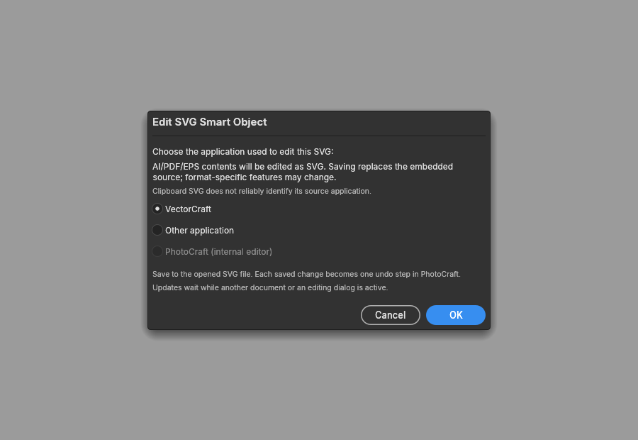

# Vector clipboard paste

On Windows, Edit > Paste opens a Paste As dialog when another application publishes SVG
under the registered `image/svg+xml` clipboard format, or as Unicode text with an SVG root.
VectorCraft can publish these representations when SVG copying is enabled. Ordinary bitmap
and internal layer copying keep their existing paste behavior.

The dialog offers:

| Mode | Result |
|---|---|
| Layers | Imported shapes and groups. Unsupported SVG features become raster layers, with import warnings. |
| Smart Object | An embedded copy of the original SVG, rendered again after transforms. |
| Pixels | One raster layer rendered from the original SVG. |
| Path | A uniquely named saved path containing the imported geometry. Paint and stroke appearance are discarded. Raster-only content and incompatible fill rules disable this mode. |
| Shape Layer | One editable shape. Multiple shapes or meaningful group compositing, including ancestor clipping masks, disable this mode. Use Layers to retain those masks. |

Pixels is the initial choice. Import warnings and unavailable-mode reasons appear before
confirmation. SVG text becomes outlines, rather than editable type. Existing SVG-import
limitations, including approximate gradient geometry in editable shapes, still apply.

The clipboard is read only after an explicit interactive paste. The dialog keeps that source
snapshot; changing the system clipboard while it is open does not change the pending paste.
Cancel makes no document edit. Confirmation uses the command registry and creates one undo
step. A changed document, editing target, or selection invalidates the pending operation.

Vector paste requires an open layered document and a normal layer target. Text editing, masks,
channels, Paste in Place, and New from Clipboard retain their existing paths. RGB, Grayscale,
CMYK, Lab, and 8/16/32-bit destinations use the existing color and depth conversion machinery.
SVG smart rendering converts sRGB source colors into the destination ICC profile, including
after scaling and warping; profile changes invalidate the relevant render caches.
An exact built-in sRGB RGB destination keeps the direct render path at its own bit depth.

## Editing pasted vector contents

Pasted Shape Layers use the shared Shape Tools controls from #2496. Imported fills and strokes
are retained; drawing-tool defaults do not replace them. Properties such as fill, stroke and
dimensions edit the native shape. Primitive-specific controls require matching primitive
metadata: an arbitrary imported path does not automatically become a rectangle or polygon.

On desktop, Layer > Smart Objects > Edit Contents offers external editing for embedded SVG,
PDF-compatible AI, PDF and EPS, including payloads retained in PSD linked-layer tables.
Choose VectorCraft, Illustrator, or an executable through the native file picker. PhotoCraft
passes a temporary SVG working copy directly to that executable, without a command shell.
The editor must save changes back to the same SVG file. Stable saves are validated and update
the existing smart object when its parent document is active and available for editing. Each
accepted update is undoable and retains placement, effects and shared-content instances.
Malformed saves and conflicting source changes leave the current contents intact.

Ordinary SVG clipboard data does not reliably identify its producing application. The editor
choice remains explicit; an SVG copy is not a link to the producer's original native project.
External editing supports Windows and Unix desktops. Linux discovery checks normal VectorCraft
install locations and the user Flatpak deployment; Other application selects an explicit local
executable. No executable is read from artwork metadata or searched for in the document folder.
The browser and automation do not launch external editors. Native Linux acceptance does not
establish Flatpak-to-Flatpak launching: sandboxed packages may require separate portal or
packaging integration; no sandbox permissions are broadened here.
WebAssembly builds omit the external-editor dialog and session polling; internal editing
and the memory-only SVG commands remain available.

PhotoCraft's internal editor remains available. Internal Edit Contents uses a PhotoCraft
document and saves its edited source as `.pcraft`; external SVG editing preserves SVG source.
Raster and PhotoCraft/PSD/PSB smart objects retain their existing internal editing behavior.

AI/PDF/EPS editing requires `vectorcraft-cli` beside the selected VectorCraft executable.
A cancellable background process converts the bounded embedded source to an SVG working copy
through VectorCraft’s headless MCP API, confined to a private temporary directory for both reads
and writes. Both open and export must succeed. Conversion times out after 60 seconds. The PSD’s
stored source-pixel frame is retained even when PDF points differ, preserving placement and warp
coordinates. Missing or unsupported stored frames fail without changing the original object.

The editor chooser explains that saving replaces the embedded source with SVG. AI/EPS-specific
features can change during conversion; this is not lossless native AI/EPS editing. Original bytes
remain unchanged until the first valid saved edit and can be restored with Undo. The working copy
is not a link to a file on the user’s drive. Windows and Unix file watchers reject symlinks and
nonregular files; Unix opens are also nonblocking and no-follow to prevent substituted FIFOs or
links from hanging the watcher or reading an unrelated target.

The memory-only `layer.smartObjects.exportSvg` and `layer.smartObjects.updateSvg` commands
support source handoff and save-back. Export returns `svg` for SVG sources or bounded
`sourceBase64` plus `extension` and optional `sourceSize` for other embedded vectors; it never
follows a linked path on disk. Save-back validates document, layer, shared contents ID
and expected source fingerprint before changing the document. These commands do not accept
filesystem paths or launch programs.

Native input and normalized SVG are limited to 16 MiB. Clipboard SVG import limits the canvas
and aggregate eager layer caches to 24 million pixels; drawings that exceed the aggregate
cache budget can fall back to one raster layer with an explicit warning. Existing SVG parser
depth and node limits remain in force. Editable shape caches are checked again against their
actual bounds on the destination canvas. If that budget would be exceeded, Layers and Shape
Layer are unavailable; Pixels and Smart Object remain alternatives. Smart-object Edit Contents
and Stack Mode reject sources whose editable caches would exceed the budget, retaining the
original embedded SVG. External image paths and URLs are not fetched.
Embedded PNG, JPEG, GIF, and WebP dimensions are checked before raster decoding, including
actual GIF/WebP frame dimensions. Their aggregate decoded pixels are capped at 24 million.
Embedded SVGs share the 16 MiB decoded XML budget, have at most 32 image nesting levels, and
their intermediate render buffers are checked at the actual render scale. Exceeding these
limits rejects the source rather than silently dropping an embedded image.

Automation does not open the dialog or read the OS vector clipboard. It supplies an explicit
payload and mode to `edit.pasteVector`, for example:

```json
{
  "svg": "<svg xmlns=\"http://www.w3.org/2000/svg\" width=\"8\" height=\"6\"><rect width=\"8\" height=\"6\" fill=\"red\"/></svg>",
  "mode": "layers",
  "center": [100, 100]
}
```

An optional integer `document` is a stable document ID and must match the active document.
The response reports the mode, inserted layer IDs or saved path name, offset, and warnings.

This first implementation supports Windows SVG. PDF clipboard representations, native vector
clipboard reads on macOS/Linux/web, Illustrator-specific private formats, and editable SVG
text are follow-up work. Synthetic clipboard and rendering tests do not establish compatibility
with every installed producer version.

## Embedded-vector validation (2026-10-22)

The extension is based on the external-SVG work in PR #3409. Local acceptance used eight
contributor-owned logo PSDs, following each mockup’s nested PSB into its embedded AI vector.
A real VectorCraft edit and Save produced a visible PhotoCraft change; child and parent Undo/Redo
and PSD export/reopen preserved the edited vector. Input hashes were unchanged. Those files,
screenshots and the private acceptance harness are not shipped. Public regression tests use
authored sources and existing permissively licensed font data.

Missing fonts can change typography. VectorCraft reports them in its existing Missing Fonts
dialog. PhotoCraft’s SVG renderer now maps unavailable generic defaults to actual installed
families, so a missing authored font falls back instead of dropping the text entirely. Install
the authored fonts for matching typography; fallback rendering is not a fidelity guarantee.

Browser builds retain internal editing. Clipboard discovery on non-Windows platforms and
lossless native AI/EPS format preservation remain outside this extension.



Offscreen dialog capture with authored bytes and mock editor services; no private artwork.
